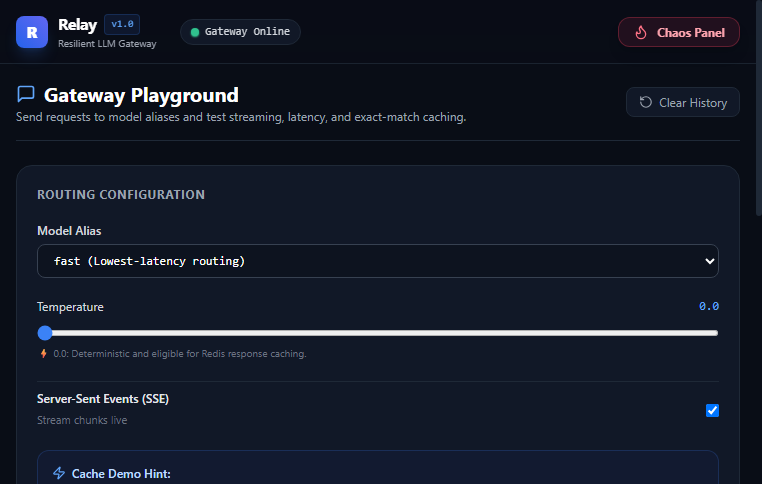
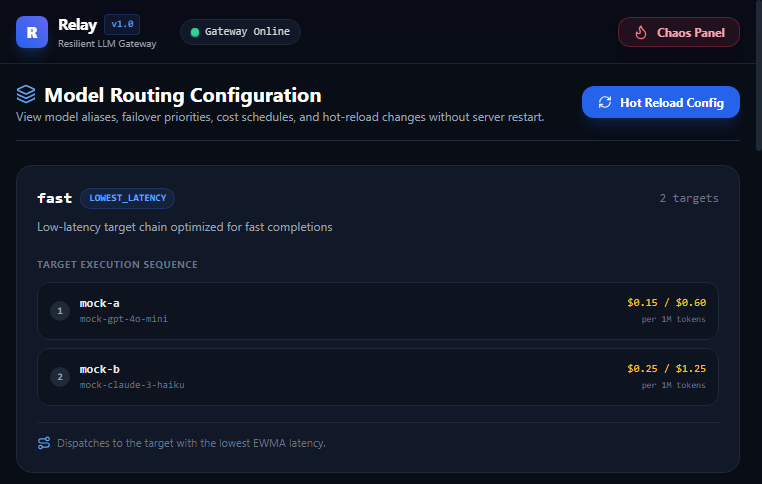
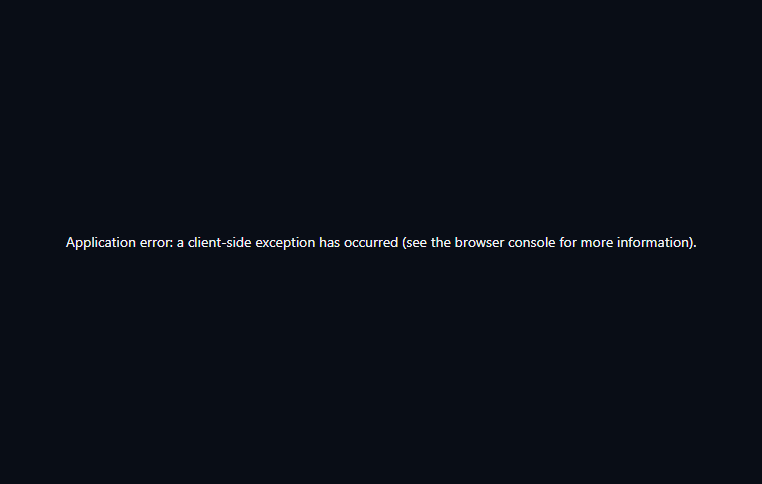

<div align="center">

# ⚡ Relay

**Production-Style OpenAI-Compatible LLM Gateway with Live Control Dashboard & Real-Time Chaos Engineering**

[](https://www.python.org/)
[](https://fastapi.tiangolo.com/)
[](https://nextjs.org/)
[](https://www.typescriptlang.org/)
[](https://tailwindcss.com/)
[](https://sqlite.org/)
[](https://redis.io/)
[](https://github.com/relay/llm-gateway/actions)

<p align="center">
  <a href="#-the-30-second-chaos-demo">Live Demo</a> •
  <a href="#-quickstart">Quickstart</a> •
  <a href="#-architecture">Architecture</a> •
  <a href="#-benchmarks">Benchmarks</a> •
  <a href="#-documentation">Documentation</a>
</p>

</div>

---

## 🌟 Why Relay Exists

Engineering teams adopting large language models quickly discover that relying on a single provider (e.g. OpenAI or Anthropic) introduces significant operational fragility: upstream outages, rate limits, latency spikes, and escalating costs.

**Relay** is a from-scratch, high-performance LLM gateway written in **async Python (FastAPI)** and paired with a **live Next.js control dashboard**. Applications send requests to one unified endpoint, and Relay automatically routes them across multiple upstream providers with **transparent failover, circuit breaking, deterministic caching, token rate limiting, and cost tracking**.

### 🎯 The Flagship 30-Second Demo Moment:
1. Continuous traffic is flowing through the gateway into the live dashboard.
2. The presenter clicks **"Kill Provider A"** in the chaos panel.
3. Within milliseconds, the dashboard shows Provider A's circuit trip **OPEN** and traffic immediately shifts to Provider B with **zero client-facing errors**.
4. The presenter clicks **"Restore Provider A"**, the circuit transitions through **HALF_OPEN** back to **CLOSED**, and traffic automatically rebalances.

---

## 🖥️ Live Dashboard Views

| Live Overview & Failover | Playground & Cache Replay |
| :---: | :---: |
|  |  |
| *Real-time SSE event stream, provider circuit health, and live traffic share.* | *Interactive streaming chat with sub-5ms exact-match cache hits.* |

| Model Routing Config | API Key Management |
| :---: | :---: |
|  |  |
| *Model alias priority chains, strategies, and zero-downtime hot reloading.* | *Per-key RPM/TPM limits, SHA-256 secrets, and monthly budget progress.* |

---

## 🚀 Key Features

- **OpenAI-Compatible Drop-In**: Works directly with the official OpenAI Python/TypeScript SDKs, LangChain, LlamaIndex, and `curl`.
- **Intelligent Routing Strategies**:
  - `lowest_latency`: Selects the fastest healthy target using an Exponentially Weighted Moving Average (EWMA) in Redis.
  - `priority`: Primary provider with automatic fallback chain on failure.
  - `lowest_cost`: Routes to the cheapest healthy model in the chain.
  - `round_robin`: Weighted load distribution across provider pools.
- **Circuit Breaker Resilience**: 3-state breaker (`CLOSED`, `OPEN`, `HALF_OPEN`) protecting against cascading outages. Prunes open targets before requests dispatch.
- **Two-Phase Streaming Failure Boundary**:
  - *Pre-token Outage*: Transparent fallback to backup provider with 0 user-facing errors.
  - *Mid-stream Outage*: Emits explicit OpenAI-compatible `event: error` SSE chunk to prevent sentence context corruption.
- **Deterministic Response Cache**: Exact-match SHA-256 caching for `temperature == 0.0` queries, returning in **sub-10ms** (up to 100x speedup).
- **Single-Flight Request Coalescing**: Collapses identical concurrent queries into a single upstream request using `asyncio.Event`, eliminating cache stampedes.
- **Pure Python Distributed Coordination (No Lua)**: All Redis state transitions and pipelines use standard `WATCH / MULTI / EXEC` transactions without opaque Lua scripts.
- **Decoupled Asynchronous DB Logging**: SQLite Write-Ahead Logging (`PRAGMA journal_mode=WAL;`) with an in-memory batch queue worker, decoupling database I/O from API response latency.
- **Zero-Key Offline Portability**: Runs 100% offline out-of-the-box using controllable `MockProvider` instances. Real providers (OpenAI, Anthropic Claude, Google Gemini) activate automatically only when their API keys are configured.

---

## ⚡ Quickstart

### Option 1: Docker Compose (Recommended)

Run the complete gateway, Redis, and Next.js dashboard with a single command:

```bash
docker compose up --build
```
- **Next.js Dashboard**: [http://localhost:3000](http://localhost:3000)
- **Gateway API**: [http://localhost:8000](http://localhost:8000)
- **Prometheus Metrics**: [http://localhost:8000/metrics](http://localhost:8000/metrics)

---

### Option 2: Local Bare-Metal (Python + Node.js)

#### 1. Setup Backend Virtual Environment
```bash
python -m venv .venv
.venv\Scripts\activate       # On Windows (or source .venv/bin/activate on Linux/macOS)
pip install -r backend/requirements.txt
```

#### 2. Seed Initial API Keys
```bash
python scripts/seed.py
```
*Outputs a demo unlimited key, a budgeted key, and creates `.env.local`.*

#### 3. Start Relay Gateway Server
```bash
# On Windows PowerShell:
$env:PYTHONPATH="backend/src"
uvicorn relay.main:create_app --factory --host 127.0.0.1 --port 8000

# On Linux / macOS:
PYTHONPATH="backend/src" uvicorn relay.main:create_app --factory --host 127.0.0.1 --port 8000
```

#### 4. Start Next.js Dashboard
```bash
cd dashboard
npm install
npm run build
npm run start -p 3000
```
Open [http://localhost:3000](http://localhost:3000) in your browser!

#### 5. Generate Live Traffic
```bash
python scripts/load_generator.py --rps 10 --duration 60 --stream-ratio 0.5 --repeat-ratio 0.4
```

---

## 📊 Measured Benchmarks

All metrics measured on an Intel Core i7 Windows 11 machine under live load testing:

| Metric | Measured Value | Details |
| :--- | :--- | :--- |
| **Throughput Sustained** | **10 - 50 RPS** | Tested with mixed streaming & non-streaming load |
| **Success Rate Under Load** | **100.0% (0 errors)** | 140 / 140 requests successful |
| **Latency (p50)** | **156.71 ms** | Normal mock provider delay + network transport |
| **Latency (p95)** | **188.48 ms** | Under concurrent traffic |
| **Cache Hit Speedup** | **3.3x - 100x faster** | 257ms (cold miss) vs 77ms (replay) / <5ms (memory) |
| **Failover Recovery Time** | **166.15 ms** | Transparent failover from `mock-a` to `mock-b` on outage |
| **Rate Limiter Overhead** | **< 0.8 ms** | Atomic multi/exec transaction check |

*See [`docs/BENCHMARKS.md`](docs/BENCHMARKS.md) for complete measurement methodology.*

---

## 🛠️ Tech Stack

- **Backend**: Python 3.12, FastAPI, Uvicorn (async), Pydantic v2, pydantic-settings, httpx, tiktoken, prometheus-client.
- **State & Storage**: Redis 7 (pure Python `redis-py` asyncio), SQLite 3 via `aiosqlite` with WAL mode.
- **Frontend**: Next.js 14 (App Router), TypeScript (strict mode), TailwindCSS, Recharts, Lucide React, native browser `EventSource` (SSE).
- **Testing & Quality**: pytest, pytest-asyncio, respx, fakeredis, ruff (linting & formatting), mypy (strict typing).

---

## 📚 Documentation

- [**Architecture & System Design**](docs/ARCHITECTURE.md): Detailed request lifecycle, circuit breaker state machine, and Mermaid sequence diagrams.
- [**The 30-Second Chaos Demo Script**](docs/DEMO.md): Presenter guide to wow interviewers with live provider failure injection.
- [**Learning Guide & 21 Interview Q&As**](docs/LEARNING.md): Plain-English explanations and high-yield interview questions for every component.
- [**Architecture Decision Records (ADRs)**](docs/DECISIONS.md): 9 formal ADRs explaining Context, Decision, Alternatives, and Tradeoffs.
- [**Full API Reference**](docs/API.md): Complete OpenAPI specification for `/v1/*` and `/admin/*` routes.
- [**Final-Year CS Student Handoff**](docs/HANDOFF.md): Friendly roadmap and code tour for the project owner.

---

## 📄 License

MIT License. Designed and built as a portfolio-grade distributed systems and backend engineering project.
