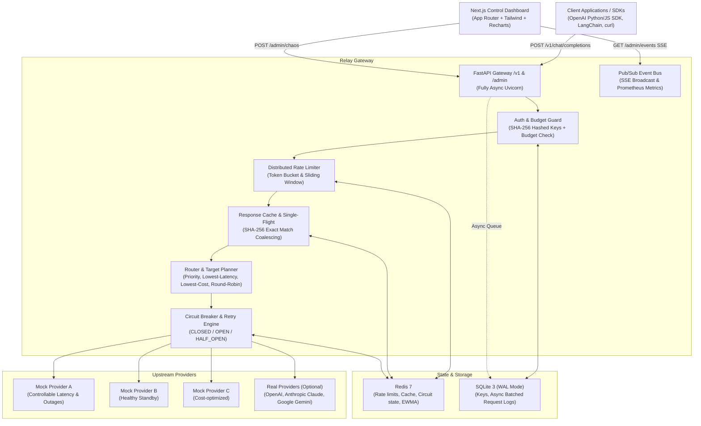
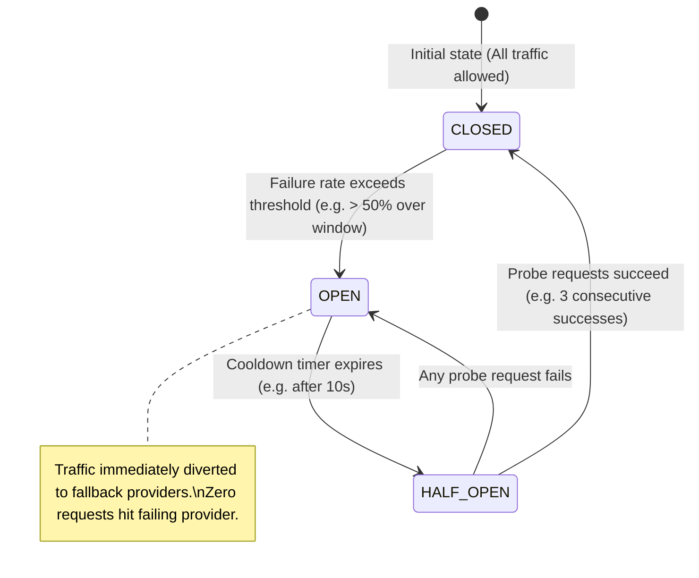
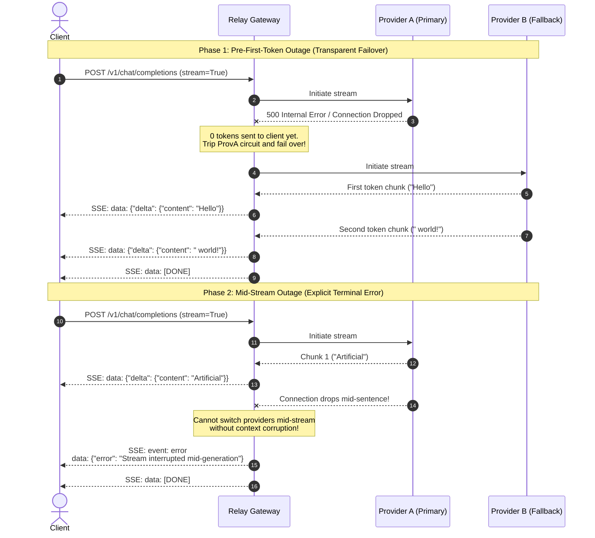

# Relay Architecture & Engineering Deep-Dive

Relay is an OpenAI-compatible LLM Gateway engineered for high availability, multi-provider resilience, intelligent traffic routing, and live operational observability.

---

## 1. System Overview

---

## 2. End-to-End Request Lifecycle

When a client sends a chat completion request (`POST /v1/chat/completions`):

1. **Authentication & Budget Check**:
   - The Bearer token is extracted and hashed with SHA-256 in constant time.
   - The key is queried from the local SQLite database.
   - The key's monthly spend is checked against its `monthly_budget_usd`. If exceeded, Relay rejects the call immediately with `HTTP 402 Payment Required`.

2. **Rate Limiting**:
   - Evaluates RPM (Requests Per Minute) and TPM (Tokens Per Minute) via the configured rate limiter (`token_bucket` or `sliding_window`).
   - If limits are reached, Relay responds with `HTTP 429 Too Many Requests` including standard `Retry-After` headers.

3. **Cache & Single-Flight Coalescing**:
   - If the request is deterministic (`temperature == 0.0`) and doesn't contain `Cache-Control: no-cache`, Relay computes a deterministic SHA-256 cache key.
   - If a cached response exists in Redis or local memory, it returns immediately with `X-Relay-Cache: HIT` (sub-10ms).
   - If concurrent identical queries arrive simultaneously, single-flight coalescing (`asyncio.Event`) ensures only one query dispatches upstream, while peers await the leader's completion.

4. **Target Planning & Circuit Check**:
   - The requested model alias (e.g. `fast`, `smart`, `cheap`, `balanced`) is resolved against `config/models.yaml`.
   - Any target provider whose circuit is currently `OPEN` is automatically pruned from the execution candidate list.
   - The remaining targets are sorted according to the alias strategy (`priority`, `lowest_latency` via EWMA, `lowest_cost`, or weighted `round_robin`).

5. **Upstream Execution & Failover**:
   - Relay attempts the first candidate provider under a per-provider concurrency semaphore.
   - If the provider drops the connection or returns a 5xx/429 before yielding tokens, Relay catches the error, records a circuit breaker failure, and transparently retries with the next candidate target.

6. **Decoupled Asynchronous Audit Logging**:
   - Once the response completes, an audit row (latency, tokens, cost, provider, status) is enqueued onto an in-memory `asyncio.Queue`.
   - An off-the-hot-path background worker flushes batches to SQLite using `executemany`, ensuring zero disk I/O latency on the API response.

---

## 3. Circuit Breaker State Machine

Each upstream provider has a dedicated 3-state circuit breaker backed by Redis sorted sets and hashes:

### State Definitions:
- **CLOSED**: Normal healthy operation. Requests pass through to the provider. Rolling failures and successes are recorded in a sliding time window.
- **OPEN**: Provider is experiencing an outage. All requests targeting this provider fail fast or are pruned during routing, instantly diverting traffic to the next fallback target.
- **HALF_OPEN**: Cooldown period has elapsed. Relay allows a limited number of test probe requests (default: 3) to test provider recovery. If all probes succeed, the circuit closes; if any probe fails, the circuit reopens for another cooldown period.

---

## 4. Streaming Failure Boundary Contract

Streaming responses (`stream=True`) present a unique distributed challenge: an upstream provider can fail either **before** the first token or **halfway** through an active response.

Relay enforces an explicit two-phase failure boundary:

---

## 5. Storage Schema & Data Models

### SQLite Schema (`relay.db` with WAL mode)
- **`api_keys`**:
  - `id` (TEXT PRIMARY KEY)
  - `name` (TEXT)
  - `key_hash` (TEXT UNIQUE): SHA-256 hash of secret token
  - `key_prefix` (TEXT): Display prefix (e.g. `rl_live_uMnC`)
  - `rpm_limit` (INTEGER): Allowed requests per minute
  - `tpm_limit` (INTEGER): Allowed tokens per minute
  - `monthly_budget_usd` (REAL): Maximum spend per calendar month
  - `allowed_aliases` (TEXT): JSON array of permitted models
  - `enabled` (INTEGER): 1 = active, 0 = disabled
  - `created_at` (TEXT ISO 8601)
- **`request_logs`**:
  - `id` (TEXT PRIMARY KEY): Unique request ID
  - `timestamp` (TEXT ISO 8601)
  - `api_key_id` (TEXT FOREIGN KEY)
  - `alias` (TEXT), `provider` (TEXT), `upstream_model` (TEXT)
  - `status` (INTEGER): HTTP status code (200, 429, 402, 500, etc.)
  - `attempts` (INTEGER): Number of upstream attempts
  - `cache_status` (TEXT): `HIT` or `MISS`
  - `latency_ms` (REAL), `ttft_ms` (REAL)
  - `tokens_in` (INTEGER), `tokens_out` (INTEGER), `cost_usd` (REAL)
  - `error_type` (TEXT)

### Redis 7 Key Schema
- `cb:{provider}:window`: Sorted set of recent request outcomes (`timestamp -> status`).
- `cb:{provider}:state`: Hash holding `state`, `opened_at`, and `half_open_probes`.
- `ratelimit:{key_id}:rpm`: Token bucket hash or sliding window sorted set.
- `cache:resp:{sha256}`: Serialized JSON response with TTL expiration.
- `ewma:latency:{provider}`: Float string of exponentially weighted moving average latency.
- `relay:events`: Pub/Sub channel for live dashboard event streaming.

